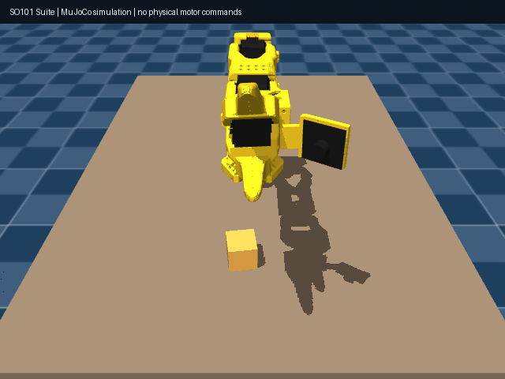

# SO101

Start with the [codebase tour](docs/codebase-tour.md) to understand the folders,
runtime services and recording flow. The [documentation index](docs/README.md)
groups the operation and engineering guides.

**Robotics workstation · exercised on ASUS ROG Zephyrus G15**

An operations workstation for turning SO-101 arm experiments into inspectable,
repeatable runs: calibration evidence, bounded motor control, live camera and
servo telemetry, simulation, and local MCAP recording.

This public preview demonstrates engineering infrastructure. Autonomous task
performance and complete hardware qualification have not been established.
The package currently identifies itself as `0.2.2rc5`.



Start with the [hardware-free mock quick start](#one-process-quick-start).
Hardware deployment examples require rig-specific configuration and validation.

## What to review

- **Resumable calibration:** per-joint reference capture, temporary-offset
  validation, register read-back, rollback and preserved raw traces. Accepted
  results are bound to calibration files by hashes; completed bundles remain
  immutable across resume.
- **Motor control boundary:** one bus owner, exclusive leases, command
  freshness, bounded targets, watchdogs and distinct Halt, Collapse and E-stop
  behavior. Standalone calibration refuses competing server ownership.
- **Observability:** shared camera relays, Foxglove visualization, servo health
  monitoring and segmented MCAP files containing images, telemetry and audit
  events, with durable episode boundaries. Recording consumes local feeds
  without acquiring motion authority.
- **Operator workflow:** leader teleop, MCAP episode start/save and bounded
  thumbstick control. The encoder twin uses the vendored SO-101 geometry;
  an independent camera overlay detects numbered motor tags.
- **Reproducible development:** explicit mock and MuJoCo modes, typed API
  contracts, fault-injection tests and CLI workflows.

### Current evidence and limits

| Area | Observed status |
| --- | --- |
| Follower calibration | Installed; ten accepted sweeps per joint; saved reference hashes verified |
| Leader calibration | Installed; six accepted initial sweeps per joint; gripper has ten |
| Leader wrist roll | A later sweep exceeded the encoder range; full-range verification remains open |
| Camera / MCAP pipeline | Four RGB feeds and motor/health/control topics recorded in tuning episodes; completed files decoded |
| Digital twin | Vendored geometry and joint transforms; frontend poses checked against backend FK; physical alignment pending |
| Software integration | Browser episode start/save and Halt exercised with mock motors and real camera relays; completed MCAP decoded |
| Camera rate | OBSBOT and D435i color exercised at about 30 fps; both icSpring feeds remain below the 30-fps target |
| Depth / camera alignment | Isolated D435i RGB-D capture exercised at 30 fps; live depth recording, D405 depth delivery and camera-to-robot alignment remain unfinished |
| Preflight | October 27 report resolves the old shoulder/rest-pose blocker; all-pose clearance and physical stop qualification remain open |
| Foreground session | Terminal launcher supports Ctrl+C Halt/rest shutdown and second Ctrl+C E-stop escalation; software signal tests pass, physical validation pending |
| Validation | Frontend checks and mock HTTP smoke pass; backend run: 3,753 passed, 51 failed, 9 skipped. See [development preview checks](docs/validation/development-preview.md); the full release gate has not passed |
| Learning results | No real-world trained-policy performance or research result claimed |

Bench observations above were collected October 23–November 1, 2026; they are
not a claim that hardware was requalified for publication. Software publication
checks are dated separately in the validation report.
The host and evidence scope are documented in [G15 validation status](docs/validation/g15.md).
Sweep counts describe repeatability evidence, not exact mechanical stops or a
proof that leader and follower physical frames match. MCAP logs are observation
records; they are not automatically synchronized, labeled training episodes.

### Code tour

See the [documentation index](docs/README.md) for setup, operation and architecture.
The [foreground-session runbook](docs/suite-session.md) covers the G15 terminal
workflow and its two-stage shutdown. Its service templates are rig-specific;
use the hardware-free quick start for a first software review.
The [teleop workflow](docs/teleop-workflow.md) explains episode recording,
thumbsticks, camera mapping and the remaining hardware prerequisites.

| Review question | Start here |
| --- | --- |
| Who can command a motor? | [RobotManager](src/so101/services/robot_manager.py), [control API](src/so101/services/routers/control.py), [safety contract](docs/control-plane-safety.md) |
| How does calibration resume without losing evidence? | [manual calibration](scripts/calibrate_arm_manual.py), [verification](scripts/verify_arm_manual.py), [regression tests](tests/test_verify_arm_manual.py) |
| How are validated recipes installed? | [transactional installation](scripts/install_arm_calibration.py), [installation tests](tests/test_install_arm_calibration.py) |
| How are camera and motor feeds recorded? | [camera relay](scripts/arm_camera.py), [MCAP recorder](scripts/record_mcap.py), [service suite](scripts/service_suite.py) |
| What is simulated? | [physics engine](src/so101/simulation/physics_engine.py), [Foxglove publisher](scripts/foxglove_viewer.py) |

The core builds on Hugging Face LeRobot and MuJoCo, with robot assets from
TheRobotStudio. Upstream dependencies and their licenses remain separate from
the application code. The sections below describe the broader platform and
development workflow; current physical validation is limited to the table above.

---

An end-to-end operations and learning workstation for the
[SO-101](https://github.com/TheRobotStudio/SO-ARM100) robot arm: connect,
calibrate, teleoperate, collect, inspect, train, simulate, evaluate, diagnose,
and safely connect camera/Quest/agent control sources. It is driven by a modern
React UI and a typed FastAPI/Python core built on
[Hugging Face LeRobot](https://github.com/huggingface/lerobot).

> The complete workflow runs with **explicit mock mode** and zero hardware.
> Real mode fails closed when its LeRobot, Feetech, calibration, camera, or
> policy dependency is missing; it never silently substitutes moving mock data.

```
operate ──► collect ──► train ──► serve ──► eval
   │           │                            │
   └── twin · Quest/hands · diagnostics · bounded agent ──┘

frontend (React+TS) ──REST/WS──► FastAPI ──► core (hardware · teleop · data ·
                                                    training · policy · eval)
                                                    └─► LeRobot / Feetech / cv2
```

## Install on the target laptop

v0.2 targets one machine: an ASUS ROG Zephyrus G15 (RTX 3070 Laptop GPU) on
Ubuntu 24.04 LTS, with both arms and an Intel RealSense plugged into it. Build
the handoff folder on any checkout with `make handoff OUT=<dir>`, copy it to
the laptop, and follow its `START_HERE.md`; in short:

```bash
bash install.sh --realsense --follower-serial SERIAL --leader-serial SERIAL
so101 doctor                       # fix every FAIL; from any folder
so101 preflight                    # arms plugged in and powered
so101 calibrate follower && so101 calibrate leader
so101 rest-pose record             # the pose Collapse lowers the arm to
so101-suite                        # http://localhost:8000
```

[docs/install.md](docs/install.md) has the details. macOS and Windows installers
exist but are unverified. What v0.2 changes, and what is still unverified on
hardware, is in [docs/SUITE_V02.md](docs/SUITE_V02.md).

## Develop (any OS, no hardware needed)

### Prerequisites

- Python 3.12 (3.13 works too; 3.14 doesn't yet: `requires-python = ">=3.12,<3.14"`).
  `make bootstrap` uses `python3.12` when it is on PATH, else `python3.13`, and
  refuses anything outside 3.12-3.13.
- Node 24 LTS with npm, for the UI.
- Behind a TLS-intercepting proxy, point pip at its CA bundle with `PIP_CERT`
  and Node with `NODE_EXTRA_CA_CERTS`.

### One-process quick start

```bash
make bootstrap                     # .venv + backend + frontend dependencies
source .venv/bin/activate          # puts so101 on PATH
SO101_MOCK=1 make suite            # build + serve at http://localhost:8000
```

The API and interactive contract are at <http://localhost:8000/docs>. For live
development, run `SO101_MOCK=1 make api-dev` and `make ui` in two terminals, or
`SO101_MOCK=1 make dev` for both. `api-dev` restarts the server on every source
change, and each restart is a full shutdown: the arm Collapses to its rest pose
with the motors off, and whatever was moving it stops. The E-stop latch and any
fault survive the restart. A real arm would collapse on every file save, so
`api-dev` refuses to run without mock hardware.
The service binds to loopback by default. Do not expose a real-arm API directly
to a LAN; put trusted HTTPS authentication in front of any Quest/remote setup.

One-image container deployment is also available:

```bash
mkdir -p data datasets outputs  # first, or Docker creates the bind mounts as root
docker compose --profile standalone up --build suite  # http://localhost:8080
```

Or drive it entirely from the CLI:

```bash
SO101_MOCK=1 so101 info
SO101_MOCK=1 so101 doctor
SO101_MOCK=1 so101 teleop --duration 5
SO101_MOCK=1 so101 record demo/pick --episodes 2 --episode-seconds 3 --no-prompt
SO101_MOCK=1 so101 datasets ls
SO101_MOCK=1 so101 train demo/pick --policy act --steps 500
SO101_MOCK=1 so101 models ls
SO101_MOCK=1 so101 run <model_path> --duration 5
```

## On real hardware from a checkout

```bash
make install-robot                 # adds [robot] (LeRobot, cv2, feetech) + [train]
source .venv/bin/activate          # puts so101 on PATH
cp .env.example .env               # set ports + camera ids (SO101_MOCK=0)
make find-cameras                  # discover physical cameras (real backend only)
make setup-motors                  # print the LeRobot id-setup command for each arm, then run both
so101 calibrate follower && so101 calibrate leader
make suite                         # build the UI and serve it at http://localhost:8000
```

`make api` (with `make ui` in a second terminal) and `so101 serve` also work with
an arm connected. `make api-dev` and `make dev` do not: they restart the server
on every source change, and each restart Collapses the arm and ends whatever was
moving it.

See [docs/hardware-setup.md](docs/hardware-setup.md) for wiring and the full
bring-up procedure.

Real mode is pinned to the tested LeRobot hardware contract. It requires saved
calibration for the exact device identity and surfaces connect failures instead
of falling back to a simulator.

## Suite surfaces

| Layer | Where | What |
| --- | --- | --- |
| **Control plane** | `src/so101/services/robot_manager.py` | Single hardware owner, exclusive leases, heartbeat/watchdog, deadman, sequence/TTL checks, faults, the E-stop / Halt / Collapse stops, servo health monitoring and SQLite audit ([docs/control-plane-safety.md](docs/control-plane-safety.md)) |
| **Hardware** | `src/so101/hardware/` | LeRobot adapters, follower/leader, three-state torque truth, cameras including Intel RealSense color and depth ([docs/realsense.md](docs/realsense.md)), native calibration and finite dt-based `SafetyGuard` |
| **Bring-up** | `src/so101/bringup/`, `so101 preflight` / `hil` | preflight checks, servo health thresholds, bus ownership, rest pose and the hardware-in-the-loop checklist ([docs/bring-up.md](docs/bring-up.md)) |
| **Teleop** | `src/so101/teleop/` | leader→follower control loop (CLI, UI, recorder share it) |
| **Data** | `src/so101/data/` | LeRobot + atomic fallback capture, episode manifests/outcomes, read-only replay preview, QC, incomplete recovery and trash restore |
| **Training** | `src/so101/training/` | ACT / Diffusion / SmolVLA / Pi0 presets, bounded single-job LeRobot trainer, a numpy-only BC baseline ([docs/learning.md](docs/learning.md)) |
| **Policy** | `src/so101/policy/` | checkpoint loading + closed-loop autonomous rollout |
| **Eval** | `src/so101/eval/` | synchronized operator scoring, abort/failure handling and durable reports |
| **Simulation** | UI + `/api/simulation`, `so101 sim`, `SO101_BACKEND=sim` | MuJoCo physics (the `sim` extra; kinematics without), simulated cameras, seeded tasks, scripted demos and policy evaluation; under `SO101_BACKEND=sim` the control plane drives the physics model and never opens a real port or camera ([docs/simulation.md](docs/simulation.md)) |
| **Quest & hands** | UI + `/api/tracking` | Real immersive WebXR hand preview plus browser MediaPipe camera tracking and deadman-gated camera teleop |
| **Diagnostics** | `/diagnostics` + SQLite events | readiness, storage, device/config/calibration state, remediation and exportable audit history |
| **Agent contract lab** | `/agent` + proposal store | deterministic or optional Responses-API proposal planner, exact one-step targets, lease/review/approval, audit and cancel |
| **CLI** | `src/so101/cli.py` | the whole lifecycle without the UI (`so101 …`) |
| **UI** | `frontend/` | Responsive command center · Teleop/Capture · Data · Twin · Quest · Train · Models · Eval · Diagnostics · Agent ([docs/operator-ui.md](docs/operator-ui.md)) |

## Configuration

All config is via `SO101_*` env vars or `.env` files. See
[`.env.example`](.env.example). Key ones: `SO101_MOCK`, `SO101_FOLLOWER_PORT`,
`SO101_LEADER_PORT`, `SO101_CAMERAS`, `SO101_HF_TOKEN`. Environment variables
win, then `./.env` in the folder a command runs in, then the data folder's
`.env` (`~/.local/share/so101/.env` on Linux, where the installer keeps the
installed suite's settings). `so101 info` lists the files in effect; see
[docs/install.md](docs/install.md#the-data-folder).

## Safety

`SafetyGuard` sits on **every** command path (teleop, replay, rollout, tracking,
manual and agent). It rejects non-finite values, intersects measured calibration
with conservative limits and rate-limits using monotonic elapsed time. External
sources additionally need one exclusive short-lived lease, explicit arm,
deadman, increasing sequence and a fresh command timestamp. E-stop is latched
until a deliberate reset and is never cleared by connect/start.

Three named stops ([docs/control-plane-safety.md](docs/control-plane-safety.md)):

| Stop | What it does | How |
| --- | --- | --- |
| **E-stop** | Torque off on every motor at once; latched until a deliberate reset | UI button or Escape, `so101 estop`, `POST /api/robot/estop` |
| **Halt** | Freezes in place with torque on; after 60 s (5 s without a supervising browser) it becomes a Collapse | UI button, `so101 halt`, `POST /api/robot/halt`; episode and skill ends |
| **Collapse** | Lowers to the rest pose at no more than 15 °/s per joint, then torque off | UI button, `so101 collapse`, `POST /api/robot/collapse`; owner disarm, shutdown, critical servo health |

A software stop is not a certified safety device. If the host process dies, the
servos keep holding their last goal; only the power switch stops them.
**Always keep a hand near the physical power switch on real hardware.**

## Development

```bash
make verify   # backend tests + Ruff + mypy + strict frontend build
make ci       # every CI job, locally (see CONTRIBUTING.md)
make fmt      # auto-format
```

Start with [Suite v0.2](docs/SUITE_V02.md), then [v0.1](docs/SUITE_V01.md) and
the [v0.0 safety foundation](docs/SUITE_V0.md). Then see
[architecture](docs/architecture.md), [control-plane safety](docs/control-plane-safety.md)
and [security](docs/control-plane-security.md), [getting started](docs/getting-started.md),
[install](docs/install.md), [hardware setup](docs/hardware-setup.md),
[bring-up](docs/bring-up.md), [simulation](docs/simulation.md),
[learning](docs/learning.md), [RealSense](docs/realsense.md),
[operator UI](docs/operator-ui.md) and [troubleshooting](docs/troubleshooting.md).
The optional proposal-only model integration is documented in
[agent-planner.md](docs/agent-planner.md).

The mock/software workstation is release-gated by `make ci`. Exact-arm hardware
remains beta until preflight and the HIL checklist pass on that arm. Quest
immersive preview, camera-hand control, monocular retargeting and model-planned
proposals are experimental and stay behind capability, deadman, or approval
gates as applicable.

## License

MIT. SO-101 hardware © The Robot Studio; LeRobot © Hugging Face.
