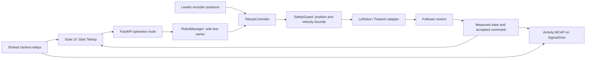

# How SO101 works

SO101 is the workstation around the leader and follower arms. The Suite UI is
the primary operator interface. Python owns hardware control and records the
evidence needed to inspect an experiment. MuJoCo provides physics simulation;
the UI's encoder view renders joint readings using the robot geometry.

## Read in this order

1. This page: folders and the path from operator input to a recording.
2. [Teleoperation workflow](teleop-workflow.md): starting, stopping and capturing.
3. [Architecture](architecture.md): runtime ownership and data boundaries.
4. [Motor tuning evidence](teleop-performance-benchmark.md): measured settings,
   camera findings and the limits of the current evidence.
5. [Contributing](../CONTRIBUTING.md): editing and checking the implementation.

## Folder map

```text
so101-suite/
├── so101, services, start       Stable workstation entry commands
├── src/so101/                  Python application
│   ├── services/               API, RobotManager, state and observation routes
│   ├── hardware/               Leader/follower adapters, calibration, guard
│   ├── teleop/                 Leader → bounded follower control loop
│   ├── bringup/                Preflight and exclusive standalone ownership
│   ├── data/                   Dataset recording, inspection and replay
│   ├── simulation/             MuJoCo, robot geometry and joint conversions
│   └── training/, policy/      Learning and inference integrations
├── frontend/src/               React application
│   ├── components/             Operator controls, cameras, arm view and widgets
│   ├── pages/                  Operate, Learn and System destinations
│   ├── hooks/                  Shared telemetry, freshness and polling
│   └── api.ts                  Browser API types and request helpers
├── scripts/                    Service processes and engineering utilities
├── config/                     Workstation launch, service and viewer files
├── configs/                    Reference robot/camera/simulation YAML presets
├── tests/                      Backend and integration regressions
├── docs/                       Guides, contracts, evidence and historical plans
├── install/, docker/           Installation and deployment
├── extensions/, thor-worker/   Optional integrations and remote worker
└── .artifacts/                 Local analysis, reports and archived build files
```

`config/` and `configs/` currently serve different purposes. The former holds
workstation integration files; the latter holds reference presets. Runtime
settings come from [config.py](../src/so101/config.py), documented by
[.env.example](../.env.example). The local `.env` is private. The folder names
remain stable because existing tools and deployments reference them.

## What runs when you start the workstation

From this checkout, `./so101` calls the service supervisor to restart the suite
and open the UI. It does not start teleoperation or grant motion authority.
The installed service definitions live in [config/services](../config/services).

| Service | Implementation | Responsibility |
| --- | --- | --- |
| Motor/API | [motor_service.py](../scripts/motor_service.py) | Serve UI/API and host the sole motor owner |
| Camera relays | [arm_camera.py](../scripts/arm_camera.py) | Capture frames once and share them with UI/recording |
| MCAP recording | [record_mcap.py](../scripts/record_mcap.py) | Record explicit episodes, calibration or diagnostics |
| Supervisor | [service_suite.py](../scripts/service_suite.py) | Start, stop and inspect services |

The external Foxglove adapter and layouts remain available for compatibility.
New inspection work is focused on the Suite UI. A running service means its
process is available; it does not prove motion readiness or clean data.

## Follow a teleoperation command



Start with [McapWorkflow.tsx](../frontend/src/components/McapWorkflow.tsx), then
[the operation routes](../src/so101/services/routers/operations.py),
[RobotManager](../src/so101/services/robot_manager.py),
[TeleopController](../src/so101/teleop/controller.py), and
[the follower adapter](../src/so101/hardware/follower.py).
The browser requests operations; it never opens a motor serial port.

Start Teleop coordinates motion startup and MCAP acknowledgement. Stop Teleop
saves the episode and Halts. The global Halt and E-stop remain separate,
immediate controls; the configured hold-to-Collapse behavior also applies.
The safety contracts are in [control-plane-safety.md](control-plane-safety.md).

## Where the data lives

| Data | Location / role |
| --- | --- |
| Private rig settings | `.env` and ignored local rig profiles |
| Calibration, rest pose and audit state | `data/real/` on the workstation |
| Episode identities and boundaries | `data/real/mcap/episodes.json` |
| Raw activity MCAPs | Configured SigmaDrive storage; open files end in `.active` |
| Derived review MCAPs and reports | `episode-reviews/` beside the configured raw MCAP directory |
| Training datasets | `datasets/`; selected and validated data, separate from raw MCAP |
| Models and run outputs | `outputs/` |
| Local analysis and old release archive | `.artifacts/` |

Raw recordings retain original timestamps. Episode export and analysis are
read-only with respect to motor control. Playback must never be confused with
the separate feature that commands a physical arm to replay a dataset.

## How to interpret the evidence

- A calibrated encoder range does not independently prove geometric alignment.
- The encoder view is measured joint data rendered on a model, not computer vision.
- A saved tuning episode is not automatically a successful task demonstration.
- Camera-requested FPS and measured capture FPS are different values.
- Current targeted test results do not establish the complete CI/HIL gate.

Historical specifications are under [plans](plans) and `SUITE_V*.md`.
[G15 validation](validation/g15.md) records qualification scope; the current
[tuning note](teleop-performance-benchmark.md) carries the latest experiment
observations. Read dates before treating an older limitation as current.
