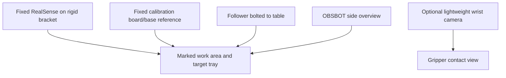

# Camera mounting and RGB-D qualification brief

Plan dated 2026-10-27. The operator confirmed the RealSense D435i and deferred
3D printing and spare-camera design. Current work uses available cameras and
existing rigid supports. The CAD requirements below are retained for later;
no print-ready fit or physical compatibility is claimed.

## Camera roles

| Camera | Initial role | Mounting choice |
| --- | --- | --- |
| RealSense | Fixed workspace RGB-D perception and geometric measurements | Rigid table/base-frame mount, outside the swept arm volume |
| OBSBOT | Operator overview, recorded experiments, independent visual checks | Fixed viewpoint; lock gimbal/tracking for calibrated sessions |
| Spare camera | Optional close-up of gripper/object contact | Trial a fixed oblique mount first; wrist mounting only after mass and cable review |
| Existing icSpring feeds | Additional views if measured quality is sufficient | Retain only useful roles; verify actual rate and exposure |

A stationary depth camera gives a stable camera-to-base transform and avoids
adding wrist payload. A wrist camera needs a rigid camera-to-tool transform
and continuously evaluated arm pose. Moving the OBSBOT changes its extrinsics;
an automatic tracking view cannot be treated as the same calibrated camera.

## Measurements before CAD

Record model/serial, camera mass, lens centers, field of view, minimum usable
depth distance at the chosen stream mode, mounting thread size/depth, hole
spacing, connector direction and cable bend envelope. Use the exact model's
[vendor datasheet](https://www.realsenseai.com/product-datasheets/); do not
reuse another model's screw specification or minimum working distance.

For the rig, measure the base/table attachment, usable workspace rectangle,
object height range, full arm envelope, sight lines and available standoff
height. For a wrist option, measure the attachment geometry, added mass and
lever arm, and cable travel through every intended joint pose. Request front,
side and mounting-face photos with a ruler if a dimension cannot be measured.

## CAD and printing deliverables

Design a parametric bracket with a replaceable camera plate, keyed orientation,
adjustable angle during setup, positive locking once aligned and cable strain
relief. Fasteners should carry the load; avoid a friction-only joint that can
creep between trials. Keep lenses, projectors, vents and connectors unobstructed.
Select material, wall thickness, inserts and print orientation after the load
and printer are known, rather than declaring an unsupported universal print.

Expected outputs: editable CAD, parameter file with measured dimensions,
STL/3MF, fastener/BOM list, print orientation and fit-test notes. Print a small
hole/attachment coupon before the full bracket. Label bracket and camera
orientation so replacement is repeatable.

## Fit and capture qualification

1. Fit with the arm unpowered and supported. Inspect cable slack and clearance
   through the intended manual travel without forcing joints or cables.
2. Confirm the RealSense's negotiated USB link and supported RGB/depth modes;
   choose a compatible SDK for that model. No RealSense was on the USB inventory
   during the initial investigation, and the suite's SDK was not installed.
3. Measure delivered fps, exposure, blur, depth validity and frame age with all
   chosen cameras and external recording running together. Target 30 fps on
   selected training RGB streams; document any lower observed rate honestly.
4. Fix intrinsics/settings, record depth scale and timestamp domain, and fit
   the rigid camera-to-base transform with measured board/reference points.
   Validate projected positions on points excluded from the fit. Recheck after
   remounting or any camera/gimbal movement.
5. Store metric depth with its invalid-pixel semantics, intrinsics and extrinsics.
   Colorized preview JPEGs cannot substitute for depth values. The existing
   three-camera JPEG relay/MCAP path needs an RGB-D extension.

The vendor's [projection and coordinate-system guide](https://dev.realsenseai.com/docs/projection-texture-mapping-and-occlusion-with-intel-realsense-depth-cameras/)
describes deprojection/projection and the transforms between optical streams.
Those factory stream transforms do not provide this rig's camera-to-robot-base
transform. That transform must be measured and versioned here.

See [RealSense implementation status](../realsense.md) and the
[manipulation roadmap](../plans/2026-10-27-manipulation-roadmap.md).
