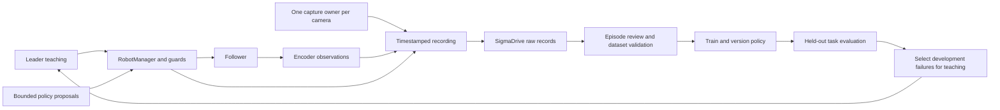

# SO-101: from dependable teleop to autonomous pick-and-place

Investigation checkpoint: 2026-10-27, G15 workstation. This is an execution
plan and a proposed experiment, not a claim of completed hardware qualification.
Keep development in the CLI and existing service/API layers until the arms
work reliably. Update the UI to expose verified behavior afterward.

Completed during this investigation: all 1,365 original MCAP files (394.4 GiB)
were migrated with destination read-back SHA-256 verification and preserved
legacy links. The final inventory audit passed. The managed recorder now
writes to SigmaDrive, and a new production segment decoded with CRC checks,
all three camera image topics, telemetry, health and encoder topics. All six
local services were verified online afterward; the arms remain disarmed with
torque off. Focused storage/service/episode tests pass. D435i SDK 2.56.5.9235
is installed and imports, but enumeration reports zero connected devices.
These results close storage work, not the physical qualification gates below.

## Intended outcome

One repeatable session: start the workstation, verify the rig, teleoperate
with the leader, mark/save demonstrations, inspect them in Foxglove, produce
a versioned training dataset, train a policy, and evaluate supervised
pick-and-place on placements excluded from training.

The first task is one easy-to-grasp block moved from a marked tabletop region
into a fixed tray. Use the follower as the manipulator and leader as its
teaching device. The SO-101 has five arm joints plus the gripper; arbitrary
six-axis end-effector poses are not all reachable.

## What exists, and what it proves

| Area | Evidence | Remaining gap |
| --- | --- | --- |
| Follower | Installed calibration; ten accepted manual sweeps per joint | Physical model zero/direction and rest-path qualification |
| Leader | Installed six-sweep baseline on all joints; ten gripper sweeps | Later wrist-roll overflow contradicts its saved range |
| Motor health | Operator confirmed both arms' motors are 12 V; profiles updated | Repeat live readiness before operation; prior supply use alone is not a health test |
| Control | Manager, leases, arming, watchdogs, Halt/E-stop/Collapse; UI controls exist | Real leader/follower workflow and stop behavior need qualification after critical test failures are resolved |
| Cameras | OBSBOT and two icSpring relays have produced live frames | Requested 30 fps does not establish delivered rate or timing; direct capture conflicts with relays |
| Visualization | Foxglove cameras/encoder topics; MuJoCo demo; encoder FK fixture checks | Physical alignment and camera projection remain unverified |
| Recording | Continuous MCAP segments and durable episode boundaries exist | Synchronized training export and restart/storage behavior need end-to-end qualification |
| RealSense | D435i confirmed; SDK 2.56.5.9235 installed/imported; adapter tests pass | SDK enumerates zero cameras; physical RGB-D capture, support and calibration unqualified |
| Autonomy | Simulation expert uses a scripted IK phase sequence | It reads privileged simulator object positions; real perception and execution are not established |
| Software gate | Previous full run: 3,561 pass, 67 fail, ten skip | Full CI/HIL is not green; seven selected failures reproduced during this investigation |

The saved real preflight had 17 passes and two skips. One required skip is
the follower rest pose: shoulder lift -105.05 degrees, outside the effective
-100-degree model limit. Its date matters: rerun after corrections, rather
than treating the saved report as live clearance. See [G15 evidence](../validation/g15.md).

Ten endpoint sweeps estimate observed travel and repeatability. They do not
independently establish mechanical angle, an encoder-to-model zero, camera
coordinates, or equal physical angles on two arms. Preserve the successful
reference files; investigate contradictory evidence rather than substituting
generic factory ranges or applying modulo arithmetic to overflow readings.

## Execution order and exit gates

All counts and thresholds below are proposed acceptance targets. They must
be checked and frozen before each measurement campaign; none is a reported
result. Software work belongs to the agent; physical setup, manual captures,
mounting and supervised motion belong to the operator.

| Stage | Work | Exit evidence |
| --- | --- | --- |
| 0. Recover storage | Finish verified MCAP migration; select the external volume by UUID; keep local episode/status metadata; refuse absent/full drive | Every inventory file has a hash receipt and accessible destination; new external MCAP decodes; missing-drive test refuses local fallback |
| 1. Establish trustworthy arm references | Resolve leader wrist roll; measure follower shoulder reference; verify motor IDs, directions and effective limits; capture a valid rest | Saved provenance/read-back agree; required preflight passes; operator verifies physical joint/model correspondence |
| 2. Qualify teleop | Resolve stop/control regressions; use one camera owner; exercise bounded leader/follower correspondence and command modes | Supervised per-joint checks, heartbeat loss, Halt/E-stop/recovery and approved rest routes have recorded outcomes |
| 3. Prove the episode pipeline | Ten pilot task episodes; start/save/interruption/restart; validate timing and actions; build a reproducible training dataset | Ten inspectable episodes, truthful timestamps and source hashes; replay and one offline training batch pass |
| 4. Install vision rig | Fixed RealSense mount first; optional wrist camera; intrinsics/extrinsics; USB/rate and depth tests | Mount repeatability, camera-to-base projection, working-distance depth and actual capture rates measured |
| 5. Establish real pick-and-place | Start with a known object placement; then RGB-D localization; bounded phase controller through the existing manager | Supervised task trials with success/failure labels and no hidden operator assistance |
| 6. Learn and compare | Train an ACT baseline; evaluate; add corrective demonstrations under a fixed teaching budget | Frozen datasets/checkpoints, held-out scores, operator-time accounting and uncertainty estimates |

The operator confirmed a D435i and deferred 3D printing and spare-camera
design. Use existing rigid supports and current cameras while stages 0–3
are completed. RealSense is not a prerequisite to proving leader teleop with
existing usable RGB cameras. A faster GPU is not a prerequisite either.

### Stage 1: resolve the two reference contradictions

Leader wrist roll: the later verification observed raw 820..4643 with installed
offset 442, giving reported 378..4201, above 4095. The original accepted recipe
covered a smaller range. Establish which physical endpoints were visited,
whether cable travel or a different wrist orientation changed the observation,
and whether register/operating-mode interpretation is consistent. Preserve
both attempts, repeat only this joint with the supported manual workflow, and
qualify any replacement recipe before installation. A computed offset that
fits the numbers is a candidate, not a validated repair.

Follower shoulder: repeated folded captures gave the same out-of-model angle.
The existing shoulder-reference tool compares the line between actual pivot
centers with the model. Capture two supported, measured side-view poses:
vertical, then 15–30 degrees away, retaining photos and the measured angle.
This distinguishes a reference/sign problem from a rest-shape problem.
Do not widen the limit to make the warning disappear. If the frame is correct,
choose a supported rest inside the verified range; a change to model limits
needs its own mechanical evidence.

Then check all motor numbers, signs and physical angles across several gentle
poses. IDs are 1 shoulder pan, 2 shoulder lift, 3 elbow flex, 4 wrist flex,
5 wrist roll, 6 gripper. Gripper percentage mapping is distinct from angular
joint mapping. Endpoint normalization is not proof of physical 1:1 alignment.

If measurements establish a frame offset or reversed sign, represent the
encoder-to-model relationship explicitly and version it. Verify both the
observation transform and inverse command transform, with limits expressed in
the correct frame. Apply the same convention to leader/follower correspondence,
the twin, recorded actions and future policy outputs. Rotating only the visual
mesh would hide the discrepancy while leaving commands inconsistent. A changed
frame invalidates dependent rest poses and must remain traceable in old data.

Home is a named, verified pose. A route to it is a separately qualified path
from a defined starting region. The existing Collapse controller does not
prove a collision-free return from every pose. Start-up register verification
is not physical auto-calibration. Autonomous hard-stop seeking stays a later
experiment until contact detection, current/load scales and travel bounds
have measured support.

### Stage 2: close the camera/control integration gap

`RobotManager._control_loop()` currently calls `cameras.open()` for teleop,
including when native dataset recording is off. The configured real camera
paths are also opened by the relay services. The UI's shared-camera preview
does not fix this capture ownership conflict. Its previous browser integration
used mock motors, so it does not establish physical teleop readiness.

Provide one capture owner with timestamped frames reused by the manager,
Foxglove, MCAP and datasets. Keep camera reads/waits outside motor I/O locks;
define bounded waits and explicit stale/missing-frame behavior. If an exclusive
handoff is used temporarily, make it explicit and test restoration. Never open
a second motor driver to work around an integration problem.

Prioritize failures involving disarm while arming, E-stop during Collapse,
fault persistence, and confirmed torque-off before powered qualification.
Some failing adapter tests have outdated fake bus contracts; repair the fake
to model mandatory torque read-back rather than weakening production checks.
Compare simulation golden-pose differences numerically before changing a
tolerance. Categorize the full failure set and run the required complete CI
gate after fixes; a focused pass is not a substitute.

### Stage 3: one authoritative demonstration record

Keep MCAP as the raw inspection/audit record, and use a versioned LeRobot
dataset for training. Existing episode markers identify intervals across
segments; they are not already exported training episodes.

Choose either the native control-tick recorder consuming shared frames or a
converter from a lossless control-tick topic. The current telemetry observer
runs independently of the control loop; interpolating it cannot recover
missing commands. The native `TeleopStep` distinguishes raw leader intent,
the guard-accepted command and follower observation. Preserve all three for
inspection and train against the declared command semantics. The current
manager telemetry snapshot omits raw intent.

Audit causal ordering as well as sample rate: the current teleop step sends
the command before reading the follower observation. Declare whether a dataset
row is a pre-command observation/action pair or a post-command transition,
and capture the needed timestamps/state accordingly. Do not silently train
against a resulting state while describing it as the state used to choose
that action. Verify any alignment/shift on a short measured sequence.

Each episode needs session/episode IDs, task/outcome/intervention labels,
camera identities/settings, calibration and model hashes, source revision,
joint order/units, wall and monotonic time mapping, per-frame capture times,
sequence numbers and drop/staleness counters. Mark interruptions explicitly.
Do not assign one post-read timestamp to every camera and call it synchronized.

Target 30 delivered frames/s for selected training RGB streams and measure
whether the rig sustains it. First record actual rates, p95 frame age/skew,
control-loop intervals and storage throughput; set numerical quality gates
before collecting the training campaign. Do not quietly relabel 5–15 fps
frames as 30 fps. 60 fps is an optional later experiment with a measured need.

Pilot acceptance includes restart during an episode, recorder loss, absent
external drive, segment rotation, and saved-episode replay. Check that failed
or interrupted episodes cannot silently become successful training examples.
Run a dataset loader and one model batch before collecting hundreds of demos.

### Stages 4–5: perception to bounded manipulation

Use the [camera mounting brief](../hardware/camera-mount-brief.md). Install
compatible RealSense support for the confirmed D435i, using an existing rigid
support before considering printed mounts. Record
RGB, metric depth, units/invalid-pixel semantics, intrinsics, extrinsics and
timestamp domain. A colorized depth preview is not metric training depth.

Calibrate camera-to-base coordinates using a rigid board or fixture with
measured reference points. Validate on points not used to fit the transform.
Set a placement tolerance from object/gripper clearance, then require
localization and motion error comfortably below that tolerance. Do not choose
an arbitrary millimetre precision claim before measuring the hardware.

First execute a supervised, known-position task to isolate motion error.
Then localize one block with simple RGB-D segmentation/geometry and run
approach → descend → close → lift → transfer → place → release → retreat.
Validate reachability, joint limits and approved workspace for every bounded
segment; abort on stale perception or uncertain state. Use camera observations
to verify the grasp and final placement. Stop through the existing host
controller; task logic and model inference do not own emergency stopping.

The existing simulation expert is a useful phase/IK reference. Its access to
simulator object state must be replaced by measured perception for real use.
Simulation checks math and task logic; camera/model correspondence still
requires physical measurements.

## Research thesis: better learning per minute of teaching

**Question:** once this inexpensive arm and its recording pipeline are stable,
can demonstrations targeted at recurring development failures improve
held-out pick-and-place success more per operator minute than collecting
additional demonstrations without failure targeting?

**Hypothesis:** with the rig, ACT architecture, training compute and initial
dataset held fixed, targeted corrections produce a larger success improvement
under equal additional operator-time budgets. This is unproven and not a
novelty claim. ACT supplies a practical imitation baseline; DAgger motivates
examining failures encountered by a learned policy, but this proposed
experiment is not automatically an implementation of DAgger. See the
[ACT paper](https://arxiv.org/abs/2304.13705),
[LeRobot ACT guide](https://huggingface.co/docs/lerobot/act), and
[DAgger paper](https://proceedings.mlr.press/v15/ross11a.html).

1. Freeze one block/tray task, camera poses, lighting range, workspace, control
   rate and success definition after the pilot. Start with 50 clean training
   demonstrations as a planning budget, revising it only before the comparison.
2. Split placements/sessions into training, development and a sealed test set.
   Never split adjacent video frames across train and test. Choose corrections
   using development failures only, never the sealed test outcomes.
3. Train the initial ACT baseline. Record misses by cause: localization,
   approach, grasp, slip, transfer, release, timing, or invalid execution.
4. Compare additional broadly sampled demos with failure-targeted corrections
   under equal operator-time budgets. Include selection, reset, teaching and
   annotation time. Add an equal-episode-count comparison to expose time-cost
   tradeoffs; do not change the architecture at the same time.
5. Evaluate both against identical held-out placements in randomized order.
   Proposed campaign: 20 placements × five repetitions per condition, and
   three training seeds where compute permits. This is a feasibility target,
   not a statistical power guarantee; size the final study from pilot variance.

Success means the block ends wholly inside the target, released and stable
for two seconds, within a frozen trial timeout, without human assistance.
Interventions and safety aborts count as task failures, with separate reasons;
report genuine equipment outages separately rather than silently dropping them.
Report success counts/rates, Wilson intervals, paired placement differences,
operator minutes, interventions, cycle time, p95 command latency, frame age,
and grasp/placement error where measurable. Preserve trial order and seeds.

Use RGB plus proprioception for the first ACT baseline; depth can support
geometric perception and evaluation first. Incorporating depth into the
policy is a separate, controlled comparison because the current RGB backbone
does not gain a valid depth input merely by recording another stream.

The useful deliverable is an honest learning curve, replayable failures,
versioned data/model manifests and a demo video. A null result is still useful
if it shows where teaching time is spent and which failures remain.

## Work queue and responsibilities

| Priority | Software deliverable | Operator contribution | Completion artifact |
| --- | --- | --- | --- |
| P0 | Verified external-storage migration and guarded recorder | Keep drive connected during transfer | Inventory, hash receipts, decoded new MCAP |
| P0 | Critical stop/fault regression repairs and camera ownership integration | None until tests pass | Regression results and complete CI report |
| P0 | Analyze wrist-roll evidence and shoulder measurements | Supported wrist sweep; two measured shoulder poses | Reviewed reference decision and clean preflight |
| P1 | Single shared capture/recording path and timing report | Ten pilot task demonstrations | Replayable episodes and validated dataset |
| P1 | D435i RGB-D integration with existing materials | Connect D435i on USB 3; secure existing rigid support | Camera calibration and sustained capture report |
| P1 | Physical encoder/model alignment and approved home route | Supervised correspondence and route checks | Pose comparisons and route qualification |
| P2 | Bounded geometric pick-and-place | Reset block and supervise trials | Task baseline and failure taxonomy |
| P2 | ACT training/evaluation and correction selection | Teaching and held-out trial resets | Learning curves and reproducible checkpoints |

Use the G15 as the device/control host. SigmaDrive stores raw recordings.
A Thor can later process datasets or run qualified inference; the current
`thor-worker/` is a qualification pack, not a proven arm-control deployment.
Do not add a network hop to stopping or put a second owner between the laptop
and arm. Establish a workload/latency need before adding that compute.

## Immediate next session

Finish storage and software investigations first. The D435i is identified;
use current materials and defer spare-camera identification and 3D printing.
Resolve only the
contradictory leader joint and follower shoulder reference, preserving other
passed calibration evidence. After required preflight and control checks
pass, perform short supervised teleop and capture the ten pilot episodes.
Mass demonstration collection and autonomous rollout follow those gates.
